<p align="center">
  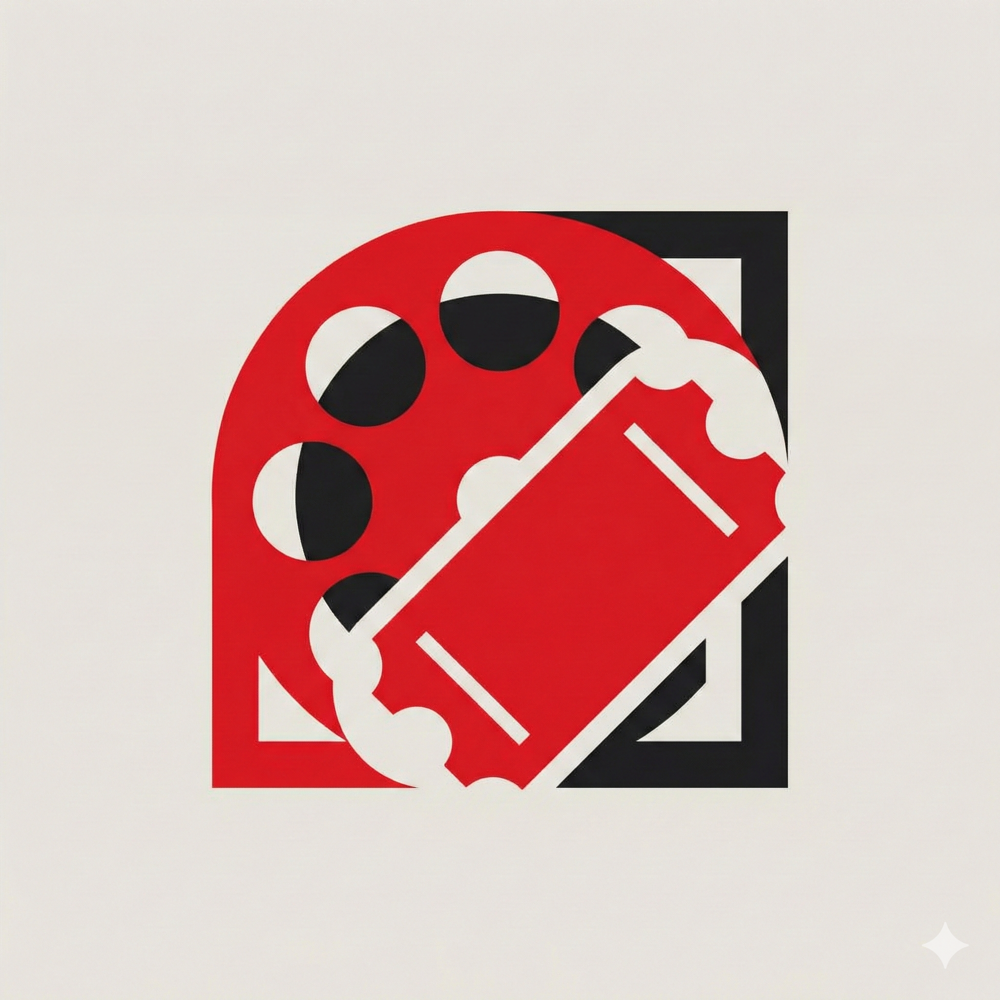
</p>

<h1 align="center">🎬 Enterprise Cinema Booking Platform</h1>

<p align="center">
  <strong>A scalable, multi-tenant cinema management platform built with the MERN Stack</strong>
</p>

<p align="center">
  <a href="#features">Features</a> •
  <a href="#tech-stack">Tech Stack</a> •
  <a href="#installation">Installation</a> •
  <a href="#usage">Usage</a> •
  <a href="#api-documentation">API</a> •
  <a href="#contributors">Contributors</a>
</p>

<p align="center">
  
  
  
  
  
  
</p>

<p align="center">
  
  
  
  
</p>

---

## 📸 Screenshots

<p align="center">
  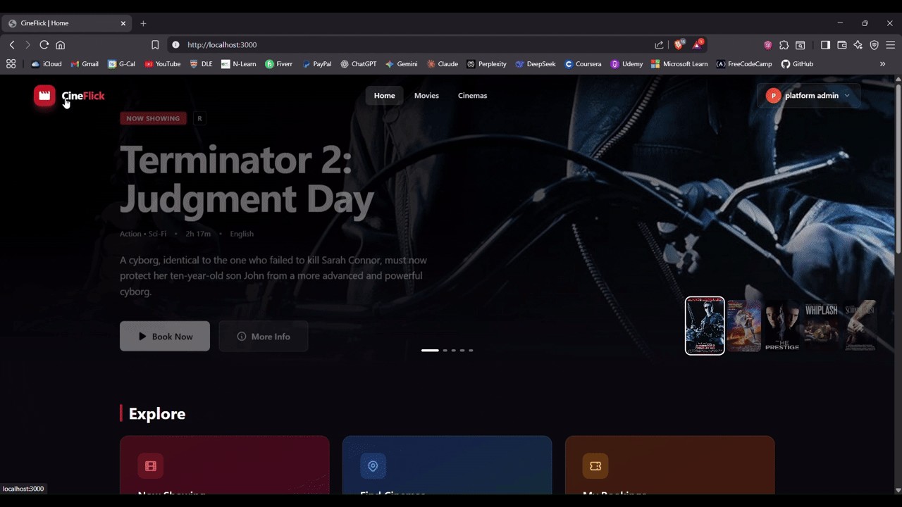
</p>

<details>
<summary><strong>🖼️ View More Screenshots</strong></summary>

<br />

| Page                     | Screenshot                                                 |
| ------------------------ | ---------------------------------------------------------- |
| **Home**        | 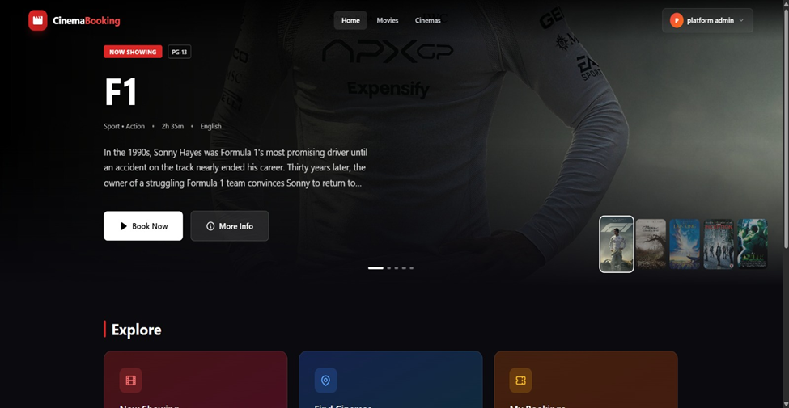              |
| **Movie Listing**        | 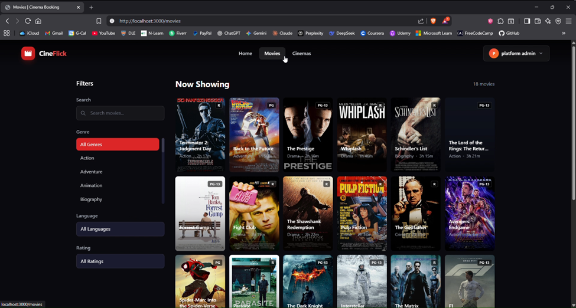              |
| **Movie Details**        | 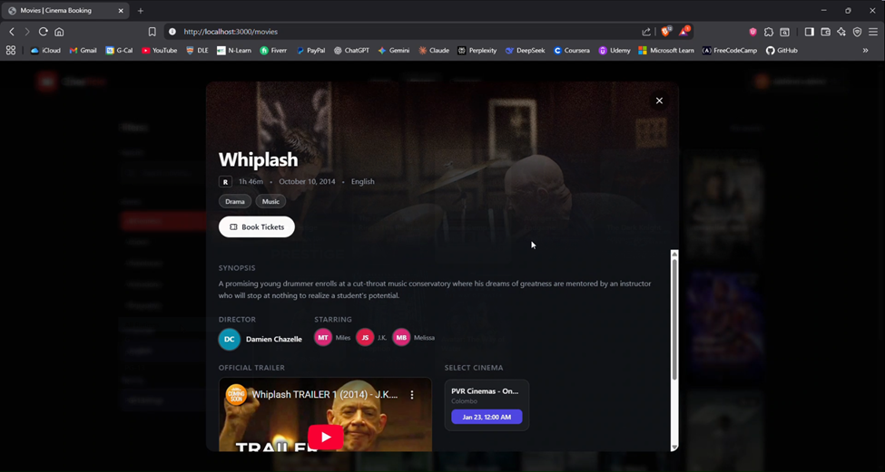 |
| **Seat Selection**       | 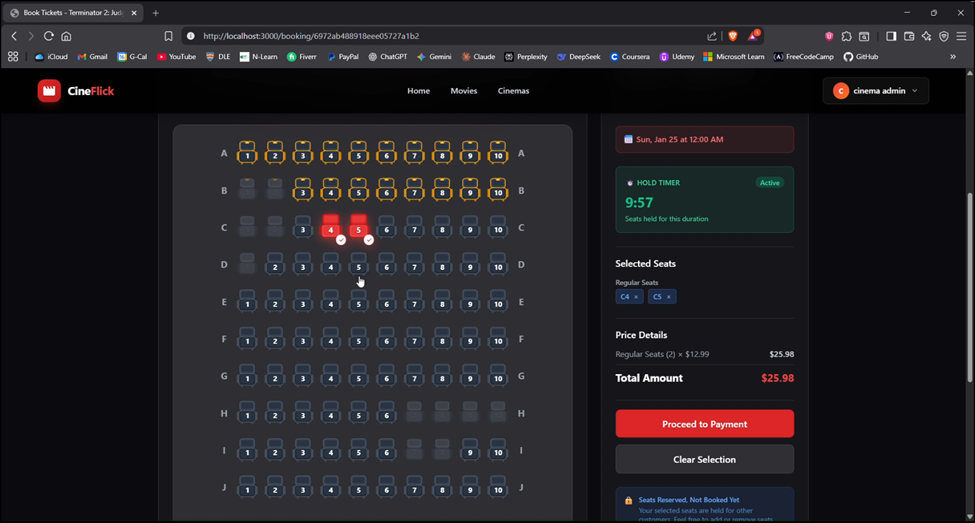       |
| **Payment**              | 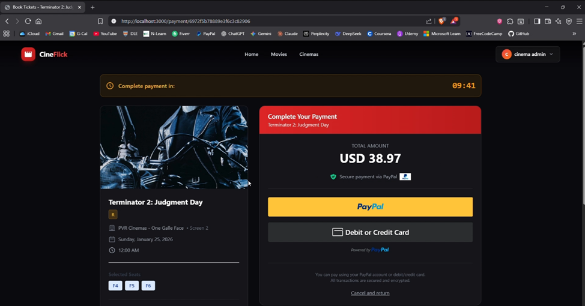            |
| **Booking Confirmation** | 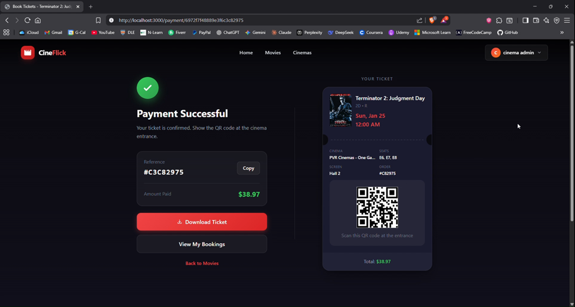  |
| **User Profile**         | 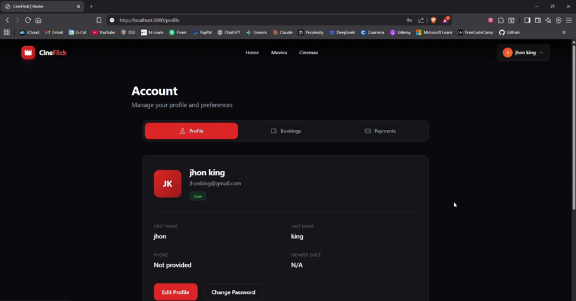            |
| **Admin Dashboard**      | 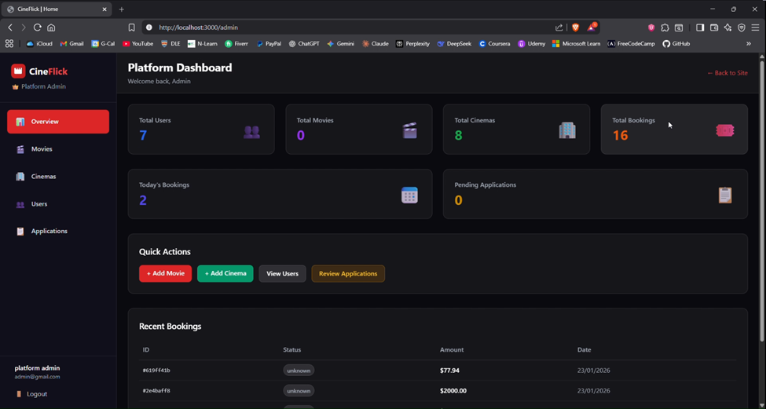                |
| **Cinema-Admin Dashboard**      | 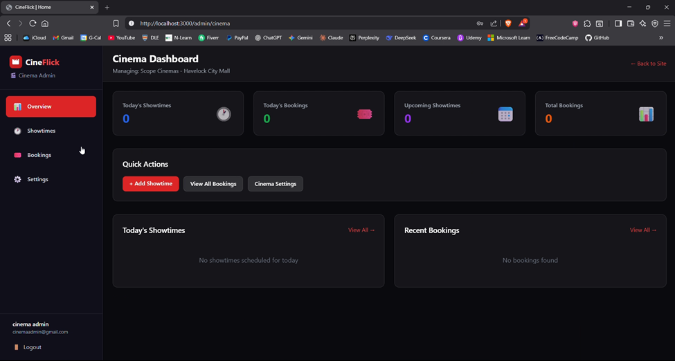                |


</details>

---

## ✨ Features

<table>
<tr>
<td width="50%">

### 🎟️ Booking System

- **Real-time seat reservation** with WebSocket updates
- **Interactive seat map** with live availability
- **15-minute booking timer** with auto-expiration
- **QR code tickets** with PDF download
- **Booking history** with status tracking

</td>
<td width="50%">

### 🔐 Authentication & Security

- **JWT-based authentication** with refresh tokens
- **Role-based access control** (User, Cinema Admin, Platform Admin)
- **Email verification** via OTP
- **Secure password hashing** with bcrypt
- **Rate limiting** & CORS protection

</td>
</tr>
<tr>
<td width="50%">

### 💳 Payment Integration

- **PayPal Checkout** integration
- **Sandbox & Production** modes
- **Automatic refund** on cancellation
- **Payment history** & receipts
- **Secure transaction** handling

</td>
<td width="50%">

### 🎬 Cinema Management

- **Multi-cinema support** (B2B platform)
- **Movie & showtime management**
- **Dynamic pricing** by showtime
- **Seating layout** customization
- **Cinema admin applications**

</td>
</tr>
<tr>
<td width="50%">

### 📊 Admin Dashboards

- **Platform Admin**: User, cinema, movie management
- **Cinema Admin**: Showtimes, bookings, analytics
- **Approval workflows** for new cinemas
- **Revenue tracking** & reports

</td>
<td width="50%">

### ⭐ Reviews & Ratings

- **Movie & cinema reviews**
- **Star ratings** with averages
- **Verified booking badge**
- **Review moderation**

</td>
</tr>
</table>

---

## 🛠️ Tech Stack

<table>
<tr>
<th align="center">Frontend</th>
<th align="center">Backend</th>
<th align="center">Database</th>
<th align="center">DevOps</th>
</tr>
<tr>
<td align="center">
<br />React 18
</td>
<td align="center">
<br />Node.js
</td>
<td align="center">
<br />MongoDB
</td>
<td align="center">
<br />Docker
</td>
</tr>
<tr>
<td align="center">
<br />TypeScript
</td>
<td align="center">
<br />Express.js
</td>
<td align="center">
<br />Mongoose
</td>
<td align="center">
<br />CI/CD
</td>
</tr>
<tr>
<td align="center">
<br />Tailwind CSS
</td>
<td align="center">
<br />Socket.io
</td>
<td align="center">
<br />Redis (Cache)
</td>
<td align="center">
<br />Jest
</td>
</tr>
</table>

### Additional Technologies

| Category             | Technologies                           |
| -------------------- | -------------------------------------- |
| **State Management** | React Query (TanStack Query)           |
| **Form Handling**    | React Hook Form                        |
| **HTTP Client**      | Axios                                  |
| **Authentication**   | JWT, bcryptjs                          |
| **Validation**       | Joi                                    |
| **Payment**          | PayPal Checkout SDK                    |
| **File Generation**  | jsPDF, html2canvas, QRCode             |
| **Testing**          | Jest, Supertest, React Testing Library |

---

## 🏗️ Architecture

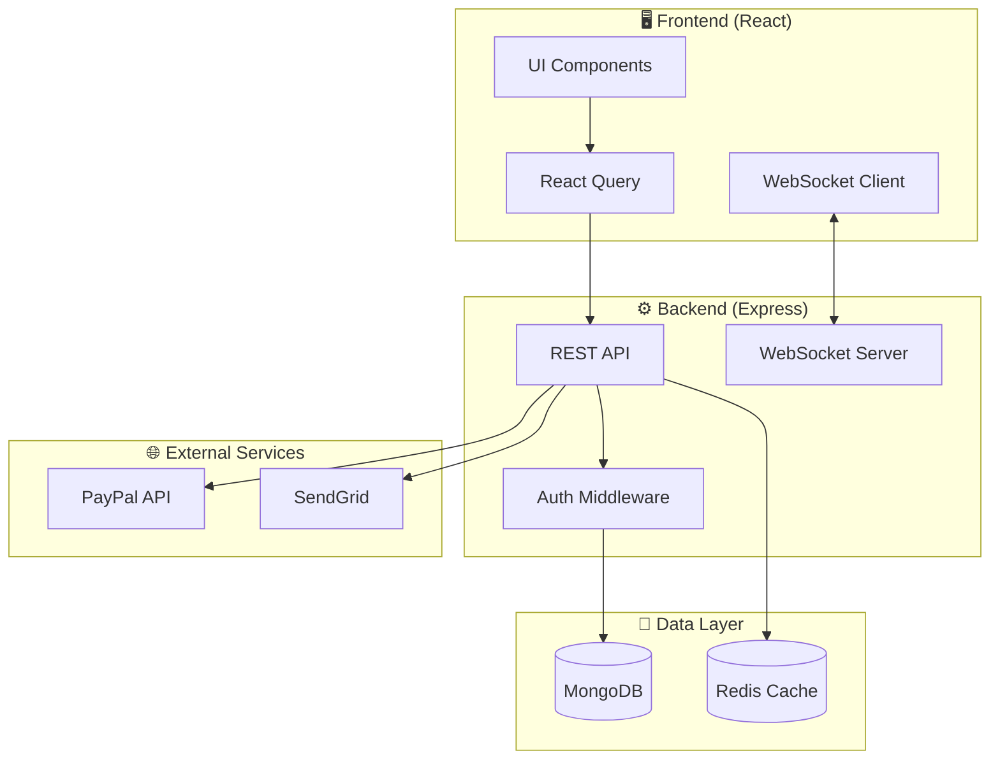

---

## 🚀 Installation

### Prerequisites

- **Node.js** >= 18.x
- **MongoDB** >= 6.0 (or Docker)
- **npm** >= 9.x

### Quick Start with Docker (Recommended)

```bash
# Clone the repository
git clone https://github.com/deaneeth/enterprise-cinema-booking-platform.git
cd enterprise-cinema-booking-platform

# Start all services
docker compose up -d

# Access the application
# Frontend: http://localhost:3000
# Backend API: http://localhost:5000
# MongoDB: localhost:27017
```

### Manual Installation

<details>
<summary><strong>📋 Step-by-step instructions</strong></summary>

#### 1. Clone the repository

```bash
git clone https://github.com/deaneeth/enterprise-cinema-booking-platform.git
cd enterprise-cinema-booking-platform
```

#### 2. Install dependencies

```bash
# Install root dependencies
npm install

# Install backend dependencies
cd backend
npm install

# Install frontend dependencies
cd ../frontend
npm install
```

#### 3. Configure environment variables

```bash
# Backend (.env in /backend directory)
cp backend/.env.example backend/.env
```

Edit `backend/.env`:

```env
# Server
PORT=5000
NODE_ENV=development

# MongoDB
MONGODB_URI=mongodb://localhost:27017/cinema-booking

# JWT
JWT_SECRET=your-super-secret-key
JWT_EXPIRES_IN=7d

# PayPal (Optional - for payments)
PAYPAL_CLIENT_ID=your-paypal-client-id
PAYPAL_CLIENT_SECRET=your-paypal-client-secret
PAYPAL_MODE=sandbox

# Email (Optional - for verification)
SENDGRID_API_KEY=your-sendgrid-api-key
FROM_EMAIL=noreply@yourcinema.com
```

#### 4. Start MongoDB

```bash
# Using Docker
docker run -d -p 27017:27017 --name mongodb mongo:latest

# Or install MongoDB locally
# https://www.mongodb.com/docs/manual/installation/
```

#### 5. Run the application

```bash
# Start backend (from /backend directory)
cd backend
npm run dev

# Start frontend (from /frontend directory - new terminal)
cd frontend
npm start
```

</details>

---

## 📖 Usage

### Default Accounts

After seeding the database (or first run), use these accounts:

| Role               | Email                | Password     |
| ------------------ | -------------------- | ------------ |
| **Platform Admin** | `admin@gmail.com` | `Admin123`  |
| **Cinema Admin**   | `cinema@gmail.com`    | `Cinema123` |
| **Regular User**   | `user@gmail.com`      | `User123`   |

### User Workflows

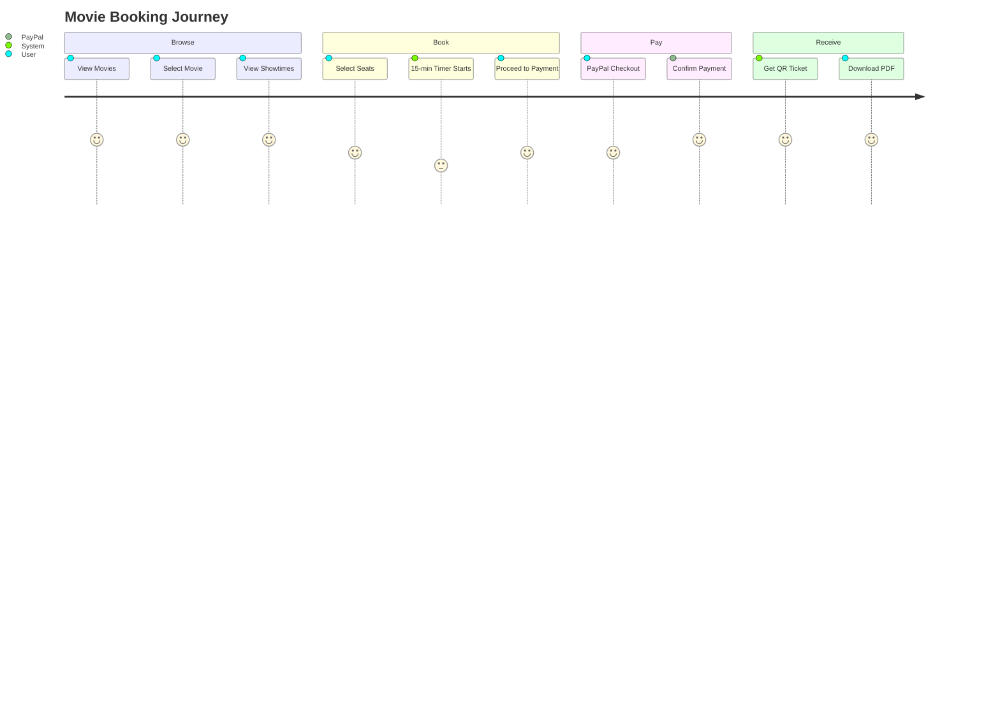

---

## 📡 API Documentation

The API follows RESTful conventions with comprehensive documentation.

### Base URL

```
Development: http://localhost:5000/api
Production: https://api.your-domain.com/api
```

### Authentication

All protected endpoints require a Bearer token:

```bash
Authorization: Bearer <your-jwt-token>
```

### Quick Reference

| Endpoint                 | Method | Description         | Auth |
| ------------------------ | ------ | ------------------- | ---- |
| `/auth/register`         | POST   | Register new user   | ❌   |
| `/auth/login`            | POST   | Login user          | ❌   |
| `/movies`                | GET    | List all movies     | ❌   |
| `/movies/:id`            | GET    | Get movie details   | ❌   |
| `/cinemas`               | GET    | List all cinemas    | ❌   |
| `/showtimes`             | GET    | Get showtimes       | ❌   |
| `/bookings`              | POST   | Create booking      | ✅   |
| `/bookings/:id`          | GET    | Get booking         | ✅   |
| `/payments/create-order` | POST   | Create PayPal order | ✅   |
| `/payments/capture`      | POST   | Capture payment     | ✅   |

<details>
<summary><strong>📚 View Full API Documentation</strong></summary>

See [API_DOCUMENTATION.md](docs/API_DOCUMENTATION.md) for complete endpoint details, request/response schemas, and examples.

</details>

---

## 🧪 Testing

```bash
# Run all backend tests
cd backend
npm test

# Run unit tests only
npm run test:unit

# Run integration tests
npm run test:integration

# Run with coverage report
npm run test:coverage

# Run frontend tests
cd frontend
npm test
```

### Test Coverage

| Module      | Coverage |
| ----------- | -------- |
| Controllers | ~80%     |
| Services    | ~85%     |
| Models      | ~90%     |
| Middleware  | ~75%     |

---

## 📁 Project Structure

```
enterprise-cinema-booking-platform/
├── 📂 backend/
│   ├── 📂 src/
│   │   ├── 📂 config/        # Database & app configuration
│   │   ├── 📂 controllers/   # Route handlers
│   │   ├── 📂 middlewares/   # Auth, validation, error handling
│   │   ├── 📂 models/        # Mongoose schemas
│   │   ├── 📂 routes/        # API routes
│   │   ├── 📂 services/      # Business logic
│   │   ├── 📂 tests/         # Unit & integration tests
│   │   ├── 📂 types/         # TypeScript definitions
│   │   ├── 📂 utils/         # Helper functions
│   │   └── 📄 server.ts      # Entry point
│   ├── 📄 package.json
│   └── 📄 tsconfig.json
│
├── 📂 frontend/
│   ├── 📂 src/
│   │   ├── 📂 components/    # Reusable UI components
│   │   ├── 📂 contexts/      # React contexts
│   │   ├── 📂 hooks/         # Custom hooks
│   │   ├── 📂 pages/         # Page components
│   │   ├── 📂 services/      # API client
│   │   ├── 📂 types/         # TypeScript types
│   │   └── 📄 App.tsx        # Root component
│   ├── 📄 package.json
│   └── 📄 tailwind.config.js
│
├── 📂 docs/                  # Documentation
├── 📄 docker-compose.yml     # Docker configuration
├── 📄 .github/workflows/     # CI/CD pipelines
└── 📄 README.md
```

---

## 🗄️ Database Schema

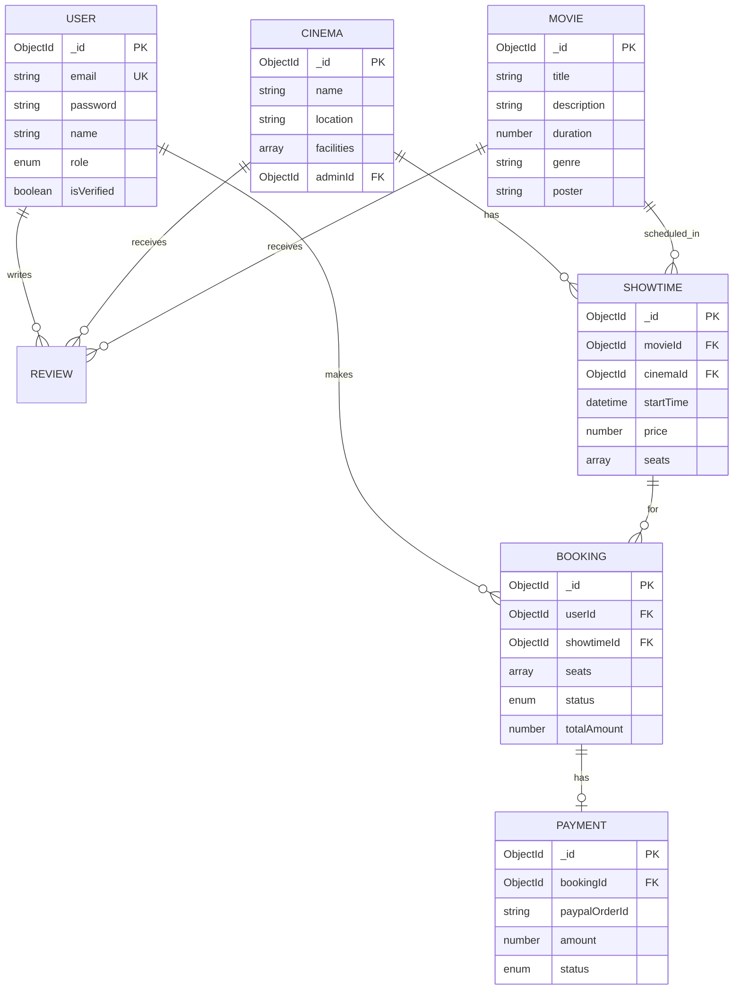

<details>
<summary><strong>📚 View Full Database Schema</strong></summary>
<p align="center">
  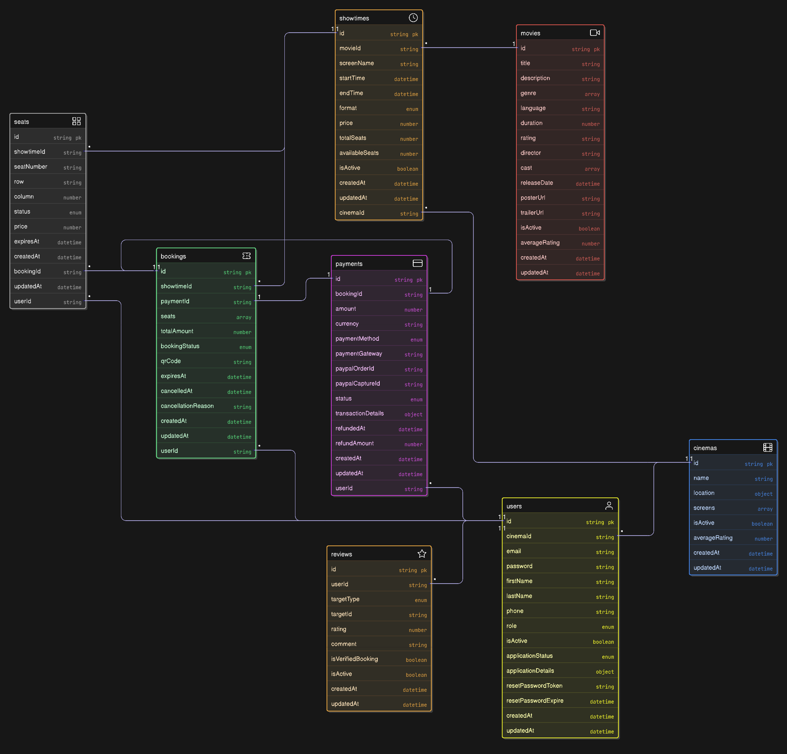
</p>
</details>

---

## 🤝 Contributors

<table>
<tr>
<td align="center">
<a href="https://github.com/deaneeth">

<br />
<sub><b>Dineth Hettiarachchi</b></sub>
</a>
<br />
<sub>Project Lead</sub>
</td>
<td align="center">
<a href="https://github.com/WickramaarachchiBS">

<br />
<sub><b>Wickramaarachchi B S</b></sub>
</a>
<br />
<sub>Backend Developer</sub>
</td>
<td align="center">
<a href="https://github.com/Himashasandeepani">

<br />
<sub><b>Himasha Sandeepani</b></sub>
</a>
<br />
<sub>Frontend Developer</sub>
</td>
<td align="center">
<a href="https://github.com/Kasuuun7">

<br />
<sub><b>Kasun Madhusanka</b></sub>
</a>
<br />
<sub>Full Stack Developer</sub>
</td>
</tr>
<tr>
<td align="center">
<a href="https://github.com/Kavix31299">

<br />
<sub><b>Kavindu</b></sub>
</a>
<br />
<sub>Backend Developer</sub>
</td>
<td align="center">
<a href="https://github.com/ashiru202">

<br />
<sub><b>Ashiru</b></sub>
</a>
<br />
<sub>Frontend Developer</sub>
</td>
<td align="center">
<a href="#">

<br />
<sub><b>Jayaweera HRK</b></sub>
</a>
<br />
<sub>Developer</sub>
</td>
<td align="center">
<a href="#">

<br />
<sub><b>Rashmi Edirisinghe</b></sub>
</a>
<br />
<sub>Developer</sub>
</td>
</tr>
</table>

---

## 📄 License

This project is licensed under the **MIT License** - see the [LICENSE](LICENSE) file for details.

---

## 🙏 Acknowledgments

- [PayPal Developer](https://developer.paypal.com/) - Payment integration
- [Socket.io](https://socket.io/) - Real-time communication
- [TailwindCSS](https://tailwindcss.com/) - Styling framework
- [React Query](https://tanstack.com/query) - Data fetching
- [MongoDB](https://www.mongodb.com/) - Database

---

<p align="center">
  <strong>⭐ Star this repository if you found it helpful!</strong>
</p>

<p align="center">
  <a href="https://github.com/deaneeth/enterprise-cinema-booking-platform/issues">Report Bug</a>
  •
  <a href="https://github.com/deaneeth/enterprise-cinema-booking-platform/issues">Request Feature</a>
</p>
